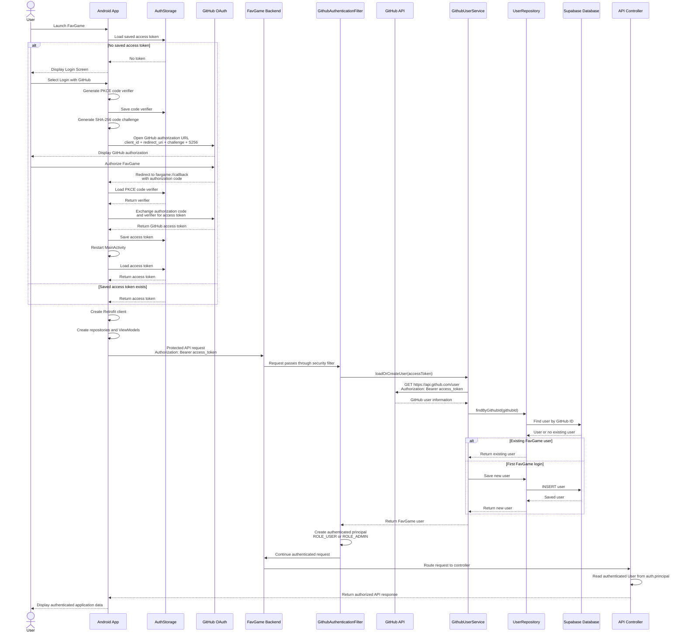

# Auth Sequence Diagram

The FavGame Android application uses GitHub OAuth Authorization Code with PKCE for authentication. 
After authentication, the GitHub access token is stored on the device and sent as a Bearer token with protected API requests.

## Authentication Summary

1. FavGame launches and checks for a saved GitHub access token.
2. If no token exists, the user is shown the GitHub login option.
3. The application generates a PKCE code verifier and SHA-256 code challenge.
4. The verifier is stored locally while the challenge is included in the GitHub authorization request.
5. GitHub authenticates the user and redirects back to `favgame://callback` with an authorization code.
6. FavGame retrieves the saved verifier and exchanges the authorization code and verifier for a GitHub access token.
7. The access token is saved locally.
8. FavGame creates its Retrofit client, repositories, and ViewModels.
9. Protected backend requests send the GitHub access token using the `Authorization: Bearer` header.
10. The FavGame backend authentication filter extracts the token.
11. The backend sends the token to the GitHub user API to identify the authenticated GitHub account.
12. The backend searches for a FavGame user with that GitHub ID.
13. If the user does not exist, a new FavGame user is created.
14. The backend creates an authenticated principal with either `ROLE_USER` or `ROLE_ADMIN`.
15. The authenticated request continues to the requested controller.
16. The controller can access the authenticated FavGame user through `auth.principal`.
17. The backend processes the authorized API request and returns the response to the Android application.