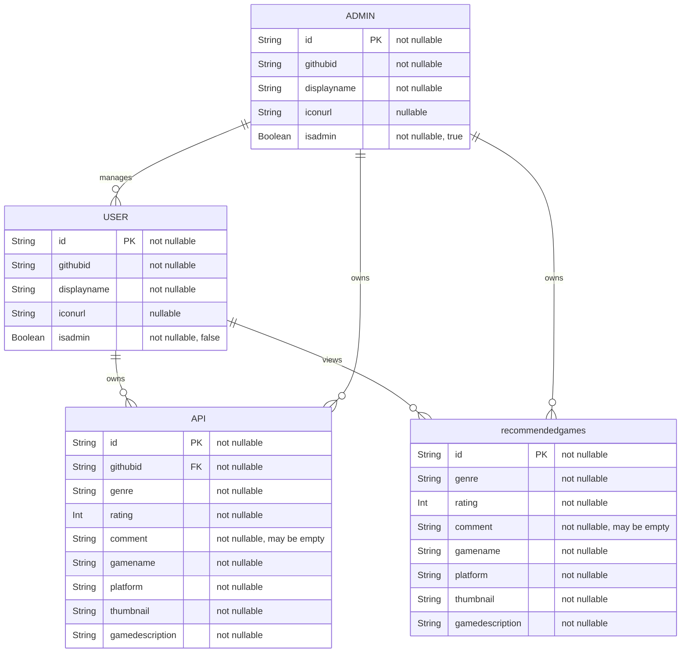

# ER Diagram

The FavGame system distinguishes between regular users and administrators. 
Both use the same underlying user data structure, but regular users have isadmin = false 
and administrators have isadmin = true.
ADMIN is shown separately in this diagram to represent the different permissions and 
relationships of the administrator role. In the implemented database, administrators are stored in the same users table as regular users.



## Relationships

- A USER can own zero or more personal games in API.
- An ADMIN can also own zero or more personal games in API.
- A USER can view the shared games in recommendedgames.
- An ADMIN can manage the shared games in recommendedgames.
- An ADMIN can manage users.
- Personal games are associated with their owner using API.githubid.

## Role distinction

Regular users and administrators are represented separately in the diagram to show their different permissions.

Regular user:

```text
isadmin = false
```

Administrator:

```text
isadmin = true
```

In the implemented backend, these are not separate database entities. Both are represented 
by the User model. The value of isAdmin determines whether Spring Security assigns ROLE_USER
or ROLE_ADMIN.

## Nullable Fields

iconurl is nullable because a user may not have a profile icon.
comment is optional when entering a game. The implemented application represents a missing comment using an empty string rather than a null value.
The other application model fields use non-null Kotlin types.