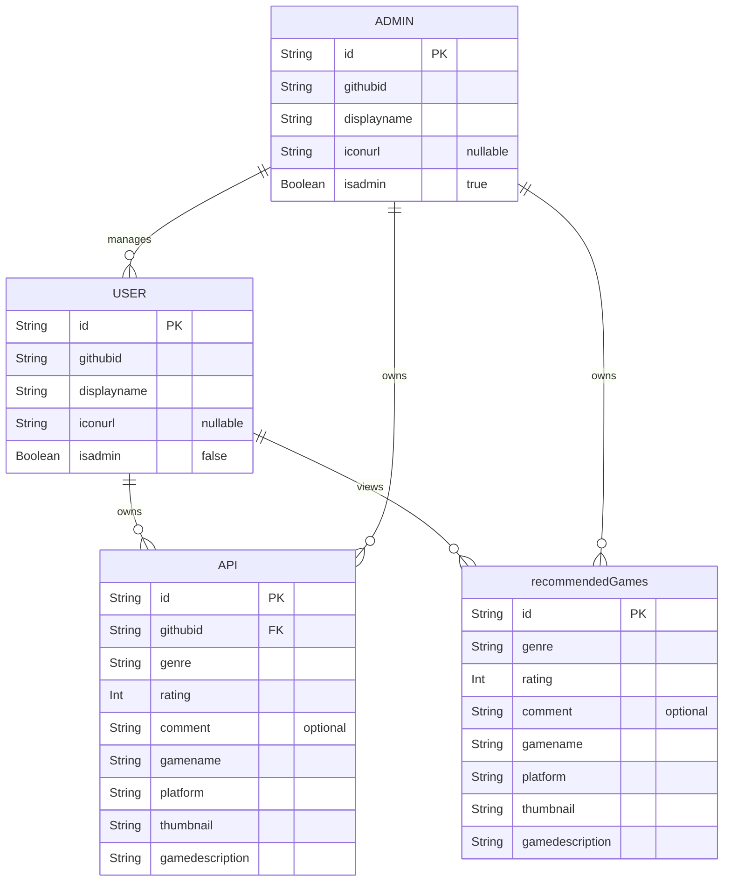

# FavGame Proposal

## 1. The pitch (one paragraph)
What the API does, who uses it, and why a client app would need it.  
The API holds user information. The API also holds personal video game information and recommended video games. This app was made for users who wish to organize and sort video games. This app was made for gamers who play a lot of video games.

## 2. Resources
| Resource | Key fields | Relationships |  
|---|---|---|  
| User | id, githubId, displayName, iconUrl, isAdmin | a User has many Games |  
| API | id, githubId, thumbnail, gameName, gameDescription, platform, genre, rating, comment | belongs to a User |  
| RecommendedGames | id, thumbnail, gameName, gameDescription, platform, genre, rating, comment | Users view and Admins manage RecommendedGames |

## 3. ER sketch
Tables, primary and foreign keys, and cardinality. Edit this Mermaid diagram (it renders on GitHub;  
try changes at [https://mermaid.live](https://mermaid.live)):

## 4. Endpoints
| Verb | Path | Auth | Purpose |  
|---|---|---|---|  
| GET | /favGame/v1/users | user | retrieve profile info |
| PATCH | /favGame/v1/users/name | user | update display name |
| PATCH | /favGame/v1/users/icon | user | update user icon |
| DELETE | /favGame/v1/users | user | delete user |
| GET | /favGame/v1/users/games?page=0&size=20 | user | list games (paginated) |
| GET | /favGame/v1/users/games?sort=alphabetical | user | sort games alphabetically |
| GET | /favGame/v1/users/games?sort=rating | user | sort games by rating |
| GET | /favGame/v1/users/games?sort=genre | user | sort games by genre |
| GET | /favGame/v1/users/games?genre={genreType} | user | filter games by genre |
| GET | /favGame/v1/users/games/search?query={gameName} | user | search games |
| GET | /favGame/v1/users/games/{id} | user | view a single game in user's library |
| POST | /favGame/v1/users/games | user | add game to user's library |
| PUT | /favGame/v1/users/games/{id} | user | replace entire game entry |
| PATCH | /favGame/v1/users/games/{id} | user | update rating or comment |
| DELETE | /favGame/v1/users/games/{id} | user | remove a game from user's library |
| POST | /favGame/v1/users/games/{id}/comments | user | add comments |
| GET | /favGame/v1/recommendations | user | view admin game recommendations |
| POST | /favGame/v1/recommendations | admin | create a game recommendation |
| PATCH | /favGame/v1/recommendations/{id} | admin | update a game recommendation |
| PUT | /favGame/v1/recommendations/{id} | admin | replace entire game recommendation |
| DELETE | /favGame/v1/recommendations/{id} | admin | delete a recommendation |
| GET | /favGame/v1/admin | admin | list all users |
| GET | /favGame/v1/admin/{userId} | admin | view one user |
| PATCH | /favGame/v1/admin/{userId} | admin | update a user (grant/revoke admin) |
| DELETE | /favGame/v1/admin/{userId} | admin | delete a user and all their data |
| ... | ... | ... | ... |  
Mark each endpoint `public`, `user`, or `admin`. Mark which collection paginates and which  
filters or sorts.

## 5. Technical choices
- **Database host:** (Neon, Supabase, Railway, Atlas, ...) and why  
  Supabase- Someone on our team has experience with this database host.
- **OAuth2 provider:** (Google, GitHub, Auth0) and confirmation that it supports Authorization Code + PKCE from a native app  
  GitHub- Yes, we confirmed that GitHub does support Authorization Code + PKCE from a native app.
- **Repo layout:** monorepo or split, and why  
  Split- it seemed easier to organize and sync the Gradle.   
  These become your ADRs later.

## 6. Risks
The two things most likely to go wrong, and what you will do first to find out.  
The front-end repo and back-end repo failing to connect? We can confirm this by running a placeholder UI with bare-bones back-end code.

## 7. Team and Sprint 1
Who owns what in Sprint 1. Link your Project board and Sprint 1 milestone.  
Owner: Jessika Torrealba jesscococ09  
Project Board:  
https://github.com/users/jesscococ09/projects/2   
Sprint 1:  
https://github.com/jesscococ09/favGameFrontend/milestone/1